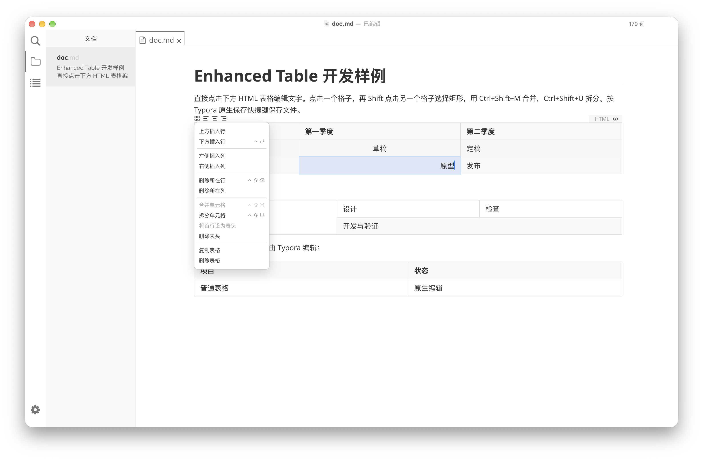

# Enhanced Table for Typora

在 Typora 中原位编辑 HTML 表格，支持合并、拆分和调整表格结构。

[安装](#安装) · [开始使用](#开始使用) · [使用边界](#使用边界) · [反馈问题](https://github.com/hazuki-keatsu/typora-enhanced-table/issues)



## 功能

- **原位编辑**：直接点击 HTML 表格中的单元格并输入文字，不需要切换源码。
- **合并与拆分**：选择矩形区域后合并单元格，也可以将合并单元格恢复为普通单元格。
- **调整结构**：插入或删除行列，支持处理已有的 `rowspan` 和 `colspan`。
- **表头操作**：将第一行设置为表头，或移除已有表头。
- **对齐方式**：将选中单元格设置为左对齐、居中或右对齐。
- **原生撤销**：使用 Typora 原生撤销、重做和导出流程，编辑结果仍保存为 HTML。

## 安装

先安装 [Typora Community Plugin](https://github.com/typora-community-plugin/typora-community-plugin)，再安装本插件。

当前插件声明的最低版本为 **Typora 1.5.0**、**插件核心 2.10.42**，目标平台为 Windows、Linux 和 macOS。*这不代表所有系统与版本组合都已完成验证，目前仅在 `macOS 27 - Typora 1.14.15 (7789)`，如有问题，请开启 Issue。*

### 手动安装

1. 从 [Releases](https://github.com/hazuki-keatsu/typora-enhanced-table/releases) 下载 `plugin.zip`。
2. 关闭 Typora，将压缩包解压到 `hazuki-keatsu.enhanced-table` 文件夹，确保 `manifest.json`、`main.js` 和 `style.css` 位于该文件夹根目录。
3. 将文件夹放入 Typora Community Plugin 的插件安装目录，详情见[官方文档](https://github.com/typora-community-plugin/typora-community-plugin/blob/main/docs/zh-cn/user-guide/2-plugin-installation.md)。
4. 重新打开 Typora，在社区插件设置的「已安装插件」中启用 **Enhanced Table**。

### 从源码构建

使用 Node.js 和 pnpm，在项目根目录运行：

```sh
pnpm install
pnpm run pack
```

生成的 `plugin.zip` 位于项目根目录，按上述步骤安装即可。

## 开始使用

在 Typora 中插入或打开一个 HTML 表格：

```html
<table>
  <thead>
    <tr><th>项目</th><th>状态</th></tr>
  </thead>
  <tbody>
    <tr><td>文档</td><td>进行中</td></tr>
  </tbody>
</table>
```

启用插件后，直接点击单元格即可编辑文字。点击一个单元格，再按住 `Shift` 点击另一个单元格，可以选择矩形区域。

| 操作 | 快捷键 |
| --- | --- |
| 创建 HTML 表格（空段落） | `Ctrl + Alt + T` |
| 合并单元格 | `Ctrl + Shift + M` |
| 拆分单元格 | `Ctrl + Shift + U` |
| 在下方插入行 | `Ctrl + Enter` |
| 删除行 | `Ctrl + Shift + Backspace` |

点击表格左上角的控制器，可以查看并使用更多操作，包括插入或删除行列、复制表格、删除表格、设置表头和调整对齐方式。

普通 Markdown 表格仍由 Typora 原生编辑，不会被插件接管。

更多交互示例见[测试文档](test/vault/doc.md)。

## 开发与测试

```sh
# 类型检查
pnpm run check

# 运行完整测试
pnpm test

# 构建开发版本并打开测试文档
pnpm run build:dev
```

测试覆盖表格布局、合并与拆分、原生撤销、编辑事件、表格控制器、国际化和浏览器行为。

## 使用边界

- 只能合并矩形区域，不能跨越 `thead`、`tbody` 等表格分组。
- 不能从纵向或横向合并单元格的中间插入、删除行列。
- 不能删除表格的全部行或全部列。
- 包含纵向合并单元格的第一行不能设置为表头。
- 插件依赖 Typora 的内部编辑接口，升级 Typora 后如果出现异常，可以先禁用插件恢复原有表格编辑行为。

这些限制用于避免隐式拆分或重排已有表格结构。反馈问题时，请附上操作系统、Typora 与插件核心版本，以及能复现问题的最小 HTML 表格。

## 许可证

本项目采用 [MIT 许可证](LICENSE.md)。

感谢 [Typora Community Plugin](https://github.com/typora-community-plugin/typora-community-plugin) 提供插件基础设施。
